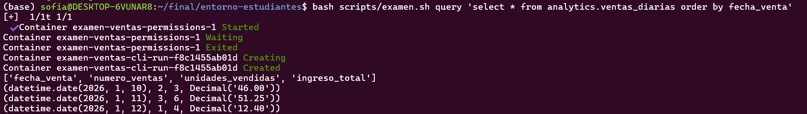
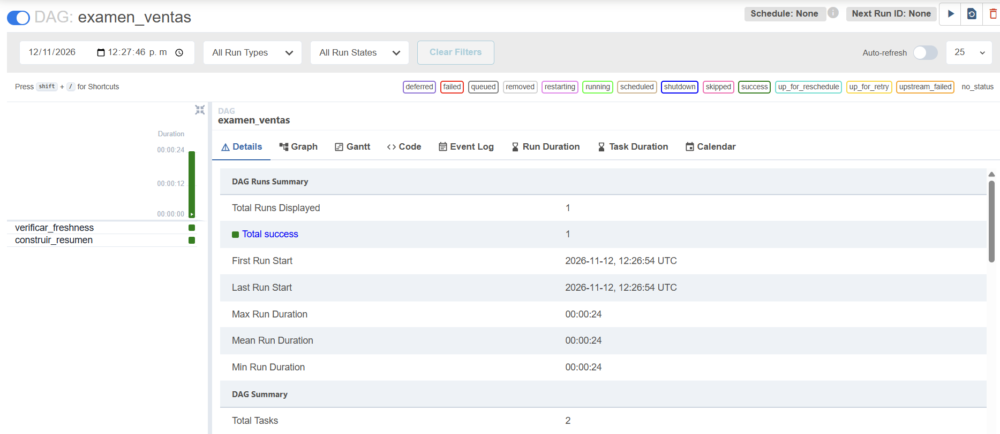
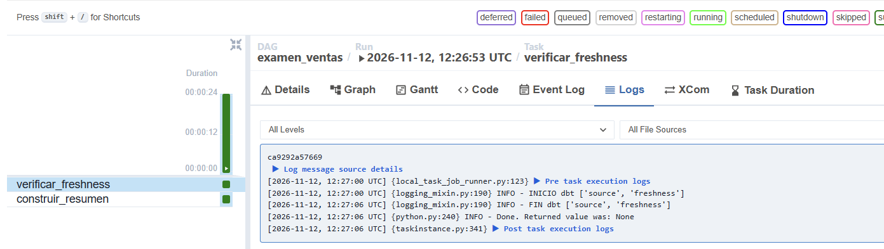
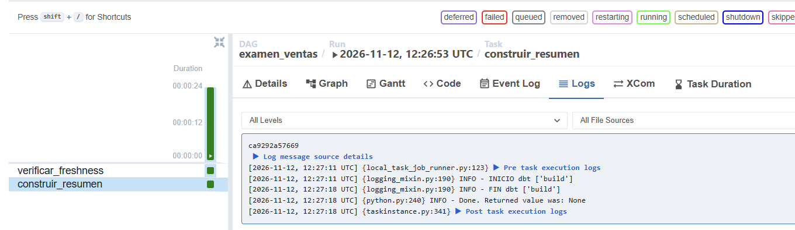
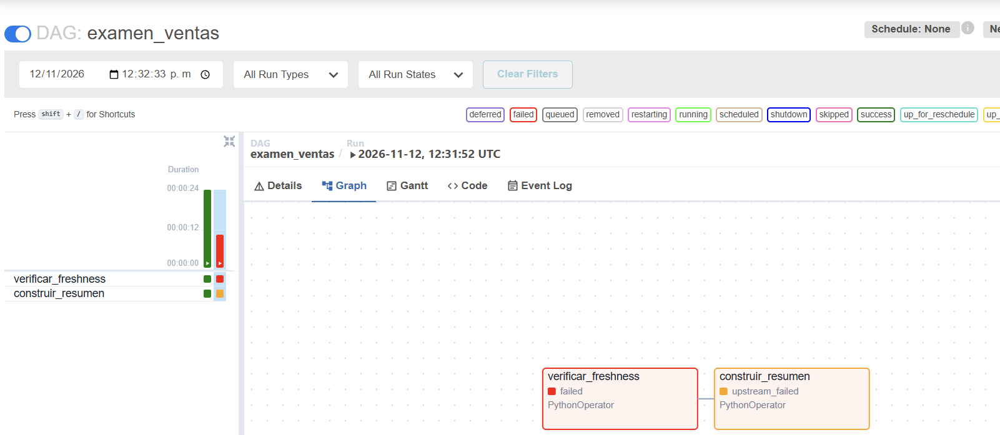
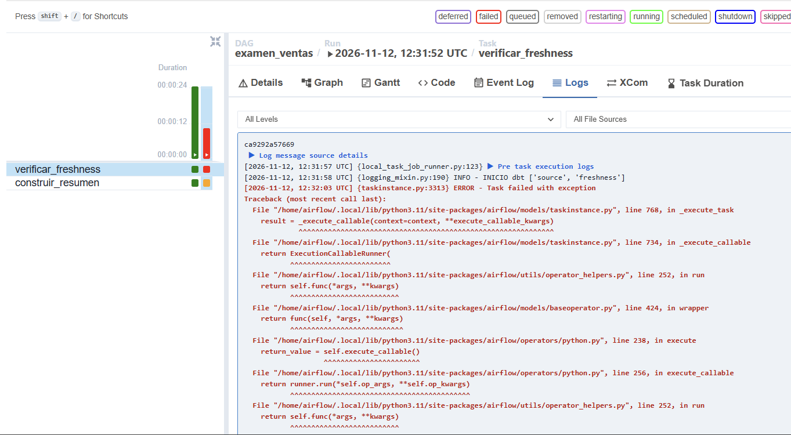
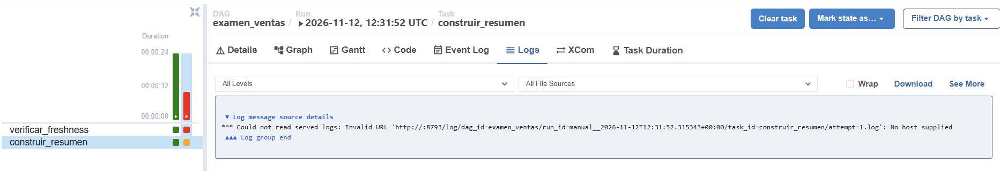
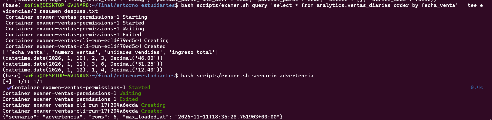

# Examen final: ventas diarias con control de actualidad

## 1. Archivos modificados

- `ventas_diarias.sql`: resumen diario agrupado por `fecha_venta` usando `ref('stg_ventas')`.
- `sources.yml`: freshness sobre `_loaded_at` con advertencia después de 12 horas y error después de 24 horas.
- `examen_ventas.py`: nueva tarea `verificar_freshness` que ejecuta `dbt source freshness` con `run_dbt`, antes de `construir_resumen`.

### ventas_diarias.sql

```sql
select
    fecha_venta,
    count(*) as numero_ventas,
    sum(cantidad) as unidades_vendidas,
    sum(cantidad * precio_unitario) as ingreso_total
from {{ ref('stg_ventas') }}
group by fecha_venta
```

### sources.yml (fragmento de freshness)

```yaml
      - name: ventas
        loaded_at_field: _loaded_at
        freshness:
          warn_after: {count: 12, period: hour}
          error_after: {count: 24, period: hour}
```

### examen_ventas.py (fragmento de la tarea nueva)

```python
    verificar_freshness = PythonOperator(
        task_id="verificar_freshness",
        python_callable=run_dbt,
        op_args=[["source", "freshness"]],
    )

    verificar_freshness >> construir_resumen
```

Se mantiene la regla de ejecución predeterminada `all_success`. Si freshness falla, `construir_resumen` queda en `upstream_failed` y no se ejecuta.

## 2. Escenario 1: fuente actualizada

Ejecución `manual__2026-11-12T12:26:53` (última carga hace unas 2 horas). `verificar_freshness` y `construir_resumen` terminaron en `success`, con freshness antes del build.

Resumen generado por el modelo:



Estados de la ejecución:



Log de `verificar_freshness` (`INICIO dbt` y `FIN dbt`):



Log de `construir_resumen` (`INICIO dbt ['build']` y `FIN dbt ['build']`):



Resumen consultado antes del bloqueo (`evidencias/1_resumen_antes.txt`):

| fecha_venta | numero_ventas | unidades_vendidas | ingreso_total |
|---|---:|---:|---:|
| 2026-01-10 | 2 | 3 | 46.00 |
| 2026-01-11 | 3 | 6 | 51.25 |
| 2026-01-12 | 1 | 4 | 12.40 |

## 3. Escenario 2: fuente desactualizada

Nueva ejecución `manual__2026-11-12T12:31:52.315343+00:00` (última carga hace unas 30 horas). `verificar_freshness` quedó en `failed` por superar las 24 horas y `construir_resumen` quedó en `upstream_failed`, sin ejecutarse.

Estados de la ejecución:



Log de `verificar_freshness` con el error de la tarea:



`construir_resumen` no tiene intento ejecutado ni marca `INICIO dbt` en esta ejecución:



Motivo del fallo: `evidencias/2_desactualizada_artifacts.txt` contiene el `sources.json` de dbt generado a las 12:32:02 UTC, con `"status": "error"` para `ventas_raw.ventas` y `max_loaded_at_time_ago_in_s` de 108027 segundos (unas 30 horas), por encima del umbral de error de 24 horas. `evidencias/2_desactualizada_log_dbt.txt` contiene el log de Airflow que registra `verificar_freshness` en `failed` y la ejecución marcada como fallida.

Resumen consultado después del bloqueo (`evidencias/2_resumen_despues.txt`). Conserva exactamente las mismas 3 filas del escenario anterior. Bloquear el build conservó el resumen anterior y no lo borró. Como los datos de negocio no cambian, la igualdad de contenido por sí sola no demuestra que el build no corrió. La evidencia de eso son los estados de Airflow (`upstream_failed` y ausencia de `INICIO dbt` en el build).



## 4. Escenario opcional: advertencia

Se preparó el escenario `advertencia` (carga de hace unas 18 horas), que debe producir `WARN` en freshness y permitir el build. Este escenario es opcional y no exige evidencia.

## 5. Preguntas conceptuales

### 1. ¿Por qué usar `_loaded_at` y no `fecha_venta` para este control?

El control busca saber si la carga de datos está al día, no cuándo ocurrieron las ventas. `_loaded_at` registra el momento en que cada registro llegó al sistema. `fecha_venta` indica cuándo ocurrió la venta en el negocio. Una venta antigua puede cargarse hoy, y en un día sin ventas la `fecha_venta` máxima no avanza aunque la carga funcione bien. Si se usara `fecha_venta`, el control podría marcar como desactualizada una fuente que sí se cargó, o dar por actualizada una fuente cuya carga se detuvo. `_loaded_at` mide directamente el retraso del proceso de carga, que es lo que se quiere detectar.

### 2. ¿Por qué las pruebas de integridad no garantizan actualidad?

Las pruebas de integridad (`unique`, `not_null` y valores válidos) solo revisan la calidad de los datos que ya están en la tabla: que no haya duplicados, nulos ni valores inválidos. No comparan los datos con la hora actual. Un conjunto cargado hace 30 horas puede cumplir todas esas reglas y aun así estar desactualizado. Sin el control de freshness, en el escenario desactualizado el build habría pasado todas las pruebas y reconstruido el resumen con información antigua. Por eso se necesita un control aparte, `dbt source freshness`, que compara el máximo de `_loaded_at` con la hora actual y bloquea el build cuando supera el umbral de error.

## 6. Contenido de la entrega

- Archivos modificados: `dbt/models/ventas_diarias.sql`, `dbt/models/sources.yml`, `airflow/dags/examen_ventas.py`
- Capturas escenario actualizada: `evidencias/ev2.png`, `ev3.png`, `ev4.png`
- Capturas escenario desactualizada: `evidencias/ev5.png`, `ev6.png`, `ev7.png`
- Log del fallo de freshness: `evidencias/ev6.png`, `2_desactualizada_artifacts.txt`, `2_desactualizada_log_dbt.txt`
- Resumen antes y después: `evidencias/1_resumen_antes.txt`, `2_resumen_despues.txt`, `ev1.png`, `image.png`
- Respuestas conceptuales: sección 5 de este documento.
- No se incluyen imágenes Docker, volúmenes, `.env` ni credenciales.
